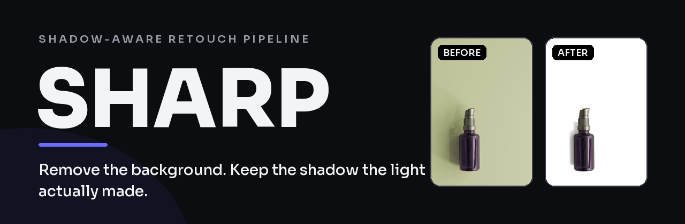
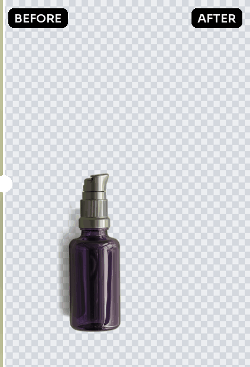
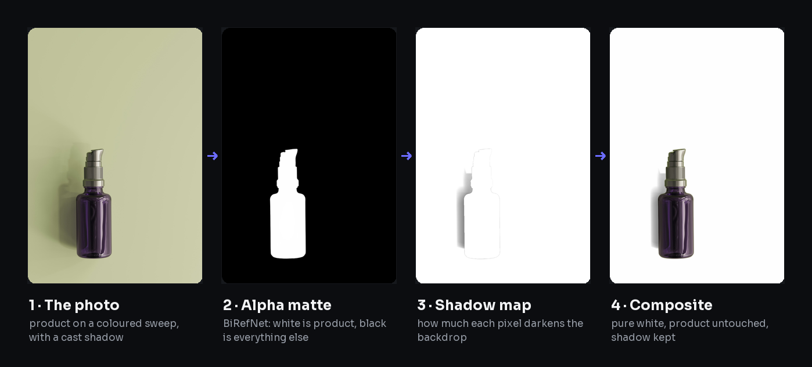

<div align="center">



<h3>Remove the background from a product photo — and keep the shadow the light actually made.</h3>

Every product pixel stays **byte-for-byte identical**. The backdrop becomes **pure white — or
drops out to transparent**. The contact shadow survives with its **real shape and softness**.
Runs locally — the photo never leaves the machine.




<sub>Real pipeline output. Source photo: <a href="https://unsplash.com/photos/19682ca159de">Unsplash</a> (free licence) — no customer photos used.</sub>

</div>

```
background removal · keep shadow · product photography · e-commerce · white background
BiRefNet · ONNX Runtime · alpha matting · FastAPI · TypeScript · offline · proprietary
```

---

## Why this exists

Conventional background removers cut out **the product** and throw everything else away. That is
the whole job as they define it: find the subject, produce an alpha matte, delete the rest. The
shadow is not the subject, so the shadow dies with the background — and with it the only cue that
tells a viewer the object is *standing on something* instead of floating in a void.

The ones that do offer a shadow usually **draw a new one**: an ellipse under the object, a blurred
copy of the silhouette, a drop shadow at a fixed angle. It is a different shadow from the one the
light in your studio actually made. Perspective, softness, direction, the way it stretches away
from the camera — none of that is preserved, because none of it was measured.

This project measures it.

The insight is old and comes from retouchers, not from machine learning: **a shadow is not a shape
to cut out, it is a multiplication.** On a white backdrop, a pixel in shadow is the backdrop times
a number below 1. So instead of segmenting the shadow, you divide the background by the light it
*would* have had with no shadow on it. Clean fabric divides to 1 and becomes pure white. Shadow
divides to 0.72 and comes back as 72% grey, in exactly the shape the light drew. This is what
Photoshop retouchers do by hand with a Multiply layer and Blend If — here it is just arithmetic.

| | Conventional remover | This project |
|---|---|---|
| What is segmented | the product | the product |
| What happens to the shadow | deleted, or replaced by a synthetic one | measured and kept |
| Perspective of the shadow | lost, or faked at a fixed angle | the one your lights made |
| Product pixels | re-encoded, sometimes recoloured | untouched, byte for byte |
| Where it runs | usually a paid API | your machine, offline |

---

## How it works

Four stages. The figures below are generated by `docs/make_figures.py` — they are the real
intermediate buffers, not illustrations.

<div align="center">

</div>

### 1. The photo

A product on a seamless backdrop. The fabric has folds, the light falls off towards the corners,
and the object casts a shadow to one side.

### 2. The alpha matte — where the product is

[BiRefNet](https://github.com/ZhengPeng7/BiRefNet) (MIT-licensed weights, ONNX Runtime, CPU) answers
one question only: **which pixels are the product**. White is product, black is everything else. It
produces no pixel that reaches the final image — the product's own photographed pixels do.

Two details matter here:

- **The threshold is deliberately low (0.22).** Where the network answers in mid-tones — a white
  leg against white fabric, a chrome edge — a 0.5 cut eats part of the product. When in doubt, the
  pixel is product.
- **Holes are closed.** On a dark part of the product the network can answer a low alpha, which
  would punch a white hole in the middle of the object. A hole is an island of "background" that
  does not touch the frame edge *and* does not carry the backdrop's light. A real see-through gap
  (between the rungs of a ladder) shows the fabric, so it carries that light and is kept.

### 3. The shadow map — how much each pixel darkens

For every background pixel: `factor = luminance / light the backdrop would have had there`.

The reference light is a wide local average taken **only over lit background pixels**, so the
shadow itself never drags the reference down. White here means "nothing to keep". Grey is the
shadow, with its gradient intact. Fabric folds land within 18% of the clean value and are rounded
to white — that is how the wrinkles disappear without touching the shadow.

### 4. The composite

`white × factor` outside the product, original bytes inside, with a soft seam between the two. No
colour correction, no saturation, no sharpening, no tone curve: lighting is a job for the softbox,
not for the software.

### 5. Or no backdrop at all

Same matte, same shadow — composited onto alpha instead of white. The clean backdrop becomes fully
transparent and the shadow is kept as semi-transparent black, so the product drops onto any page
with its shadow intact. This is the **Transparent** toggle in the studio; it exports a PNG where
white mode exports a JPEG.

---

## Install

```bash
git clone https://github.com/crispinzz/shadow-aware-bg-removal
cd shadow-aware-bg-removal

# segmentation server (Python 3.11+)
pip install -r server/requirements.txt
python server/baixar_modelo.py birefnet-general-lite   # 224 MB, once (product matte)
python server/baixar_modelo.py shadow-matte            # 6 MB, once (our shadow weights)
python -m uvicorn app.main:app --host 127.0.0.1 --port 8000 --app-dir server
```

The server binds to `127.0.0.1` on purpose. Nothing is uploaded anywhere.

## Use it

### From the command line

```bash
python docs/make_figures.py path/to/photo.jpg
# docs/figures/04-output.png is the result; 02-matte and 03-shadow-map show the reasoning
```

### From the browser

`src/backdrop.ts` is dependency-free TypeScript that runs in any browser. Give it the photo and the
matte; it does the compositing at full resolution:

```ts
import { smoothBackdrop } from "./src/backdrop";

const result = await smoothBackdrop(
  photoBlob,        // the original file, full size
  "photo.jpg",
  shadowBrush,      // optional: a canvas where you painted over a faint shadow
  matteImage,       // the matte from the server, any size — it is scaled to fit
  eraserBrush,      // optional: a canvas where you painted objects to delete
);
// result.file      the finished JPEG
// result.coverage  fraction of the frame that became background
```

Two optional brushes exist because no model is right every time:

- **Shadow brush** — paint over a shadow that is too faint to clear the fold threshold, and it is
  kept regardless.
- **Eraser** — paint over anything the network insisted on calling product (a tripod, a box, the
  corner of a table) and it becomes background.

`web/` holds the React page these screenshots come from: a drag-and-drop stage with a before/after
curtain, both brushes, light and dark themes.

## Training our own weights

The product matte comes from [BiRefNet](https://github.com/ZhengPeng7/BiRefNet), and it should:
segmenting the subject is a solved problem, and no single machine is going to beat weights trained
on DIS5K with a cluster. Competing there would be vanity.

The weights worth training are for the question nobody else asks. `training/train_shadow.py`
trains a **shadow matting** network: for every background pixel, *how much did the object darken
the backdrop here* — a continuous factor in [0, 1], not a binary mask. Every public shadow dataset
but one ships binary masks, which throws away the very thing that makes a shadow look real.
[ISTD](https://github.com/DeepInsight-PCALab/ST-CGAN) ships the shadow-free version of each frame,
so the factor is directly computable as `shadow / shadow_free`, per pixel.

```bash
python training/train_shadow.py --data /path/to/ISTD --epochs 40 --batch 8
python training/export_onnx.py runs/shadow-best.pt server/modelos/shadow-matte.onnx
```

The network is a deliberately small U-Net (1.9M parameters). A shadow is a low-frequency field: a
deep decoder spends its capacity inventing grain that is then multiplied into the photo, where it
shows immediately. The loss is L1 over the pixels where the ratio is meaningful, plus a gradient
term — matching the derivative is what keeps the penumbra landing in the right place instead of
becoming a blurred blob.

Honest about cost, measured rather than guessed. `training/bench_cpu.py` times a real training
step on your machine; on an Intel i5-13400 with no GPU at all it prints:

| side | batch | s/step | 40 epochs on ISTD |
|---|---|---|---|
| 256 px | 4 | 1.6 s | 6 h |
| 320 px | 4 | 2.9 s | 11 h |
| 384 px | 4 | 4.3 s | 16 h |

A plain desktop CPU trains this overnight, and peak memory stays near 1.5 GB at 320 px. That is
the payoff for keeping the network small: no GPU, no cloud bill, no CUDA. Fine-tuning a subject
segmenter is the opposite — that one belongs on a rented GPU.

**Why a network beats the arithmetic.** The analytic method in `src/backdrop.ts` divides the
background by the light it would have had. That holds on a plain seamless sweep and nowhere else.
It has no answer for a textured or coloured backdrop (dividing out the light also divides out the
texture), for a shadow that leaves the floor and climbs a wall (the reference light jumps), for two
lights casting two shadows of different densities, or for a translucent object where part of the
darkening is transmission rather than occlusion. Those are the cases where the factor map has to be
predicted instead of measured.

## Tuning

Every constant lives at the top of `src/backdrop.ts` with the reason it has that value:

| Constant | Default | What it decides |
|---|---|---|
| `ALFA_PRODUTO` | `0.22` | above this alpha, the pixel is product and is never touched |
| `RUGA` | `0.18` | up to 18% darker than clean backdrop counts as a fabric fold → white |
| `SOMBRA_MIN` | `0.55` | a shadow never darkens past this, or it reads as a hole |
| `SOMBRA_ALCANCE` | `0.06` | shadows are only kept this close to the product's bounding box |
| `RAIO_LUZ` | `1/22` | radius of the "light the backdrop would have had" average |

## Requirements

Python 3.11+, ~2 GB RAM for inference, no GPU needed. A 12 MP photo takes about 25 s on a laptop
CPU; the photo is downscaled to 1400 px for the network and the matte is scaled back up, because
the network reasons at 1024 px anyway.

## Licence

All rights reserved — see [LICENSE](LICENSE). This project is proprietary; no use or
redistribution without written consent. The BiRefNet weights are MIT, from
[ZhengPeng7/BiRefNet](https://github.com/ZhengPeng7/BiRefNet), and keep their own licence.

---

### Keywords

remove background from product photo, keep shadow, preserve shadow background removal, white
background product photography, e-commerce photo editing, alpha matte, BiRefNet ONNX, local
background removal, offline rembg alternative, multiply shadow compositing, seamless backdrop
wrinkle removal, catalogue photography automation.
